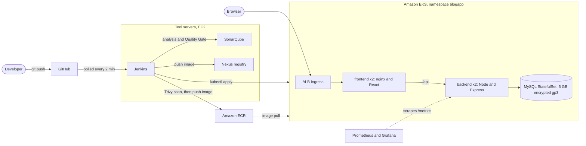

# Marginal Blog App: three-tier CI/CD on Amazon EKS

A three-tier blog application (React frontend, Node.js/Express backend, MySQL database) deployed to
**Amazon EKS** by a **Jenkins** pipeline. Every commit is built, tested, analysed with **SonarQube**,
scanned with **Trivy**, published to **Nexus** and **Amazon ECR**, and rolled out to the cluster.
**Prometheus and Grafana** monitor the result.

This is the Project 04 submission. Evidence for every requirement is in [PROOFS.md](PROOFS.md), with the
screenshots in [docs/screenshots/](docs/screenshots/).

| Submission item | Where |
| --- | --- |
| GitHub repository | this repository |
| Execution screenshots | [PROOFS.md](PROOFS.md) and [docs/screenshots/](docs/screenshots/) |
| Application URL | `http://k8s-blogapp-blogappi-d90fd8a440-1308316034.ap-south-1.elb.amazonaws.com` |

## Architecture



## What runs where

| Piece | Details |
| --- | --- |
| Region | `ap-south-1` (Mumbai) |
| Cluster | `blogapp-eks-cluster`, Kubernetes 1.34, 2 x `m7i-flex.large` managed nodes ([eks-cluster.yaml](eks-cluster.yaml)) |
| Frontend | React (Vite) built into static files, served by non-root `nginx-unprivileged` on port 8080, 2 replicas |
| Backend | Node 22 Express API on port 5000, 2 replicas. `/healthz` (liveness), `/readyz` (checks the database), `/metrics` (Prometheus) |
| Database | MySQL 8 StatefulSet with a persistent 5 GB encrypted `gp3` volume, schema loaded from [database/init.sql](database/init.sql) |
| Ingress | AWS Load Balancer Controller creates an internet-facing ALB (HTTP) |
| Tool servers | Two EC2 instances: Jenkins; SonarQube and Nexus (Docker) |
| Monitoring | `kube-prometheus-stack` (Prometheus, Grafana, Alertmanager) in namespace `monitoring` |

## Repository layout

```
.
├── Jenkinsfile                  CI/CD pipeline (11 stages)
├── docker-compose.yml           local run of all three tiers
├── eks-cluster.yaml             EKS cluster definition for eksctl
├── frontend/                    React app, Dockerfile, nginx template, .env.example
├── backend/                     Express API, Dockerfile, Jest tests, .env.example
├── database/init.sql            schema and sample posts
├── k8s/
│   ├── admin/                   applied once by an admin: namespace, gp3 StorageClass, read-only RBAC role
│   ├── app/                     applied by Jenkins on every deploy: ConfigMap, MySQL, backend, frontend, Ingress, NetworkPolicies
│   └── monitoring/              Prometheus ServiceMonitor, alert rules, Grafana dashboard JSON
├── PROOFS.md                    requirement-by-requirement evidence
└── docs/screenshots/            execution screenshots
```

## Run it locally

Prerequisites: Docker Desktop.

```bash
cp backend/.env.example backend/.env       # then put real values in backend/.env
cp frontend/.env.example frontend/.env
echo "MYSQL_ROOT_PASSWORD=<a value you choose>" >> backend/.env
docker compose --env-file backend/.env up --build -d
```

Open http://localhost:3000, register a user, publish a post. Backend health: http://localhost:5000/readyz.
Registering is required because the sample user in `init.sql` has no usable password.

The backend refuses to start if `DB_PASSWORD` or `JWT_SECRET` is missing. There are no default values in code.

## The pipeline

Defined in [Jenkinsfile](Jenkinsfile). Jenkins polls GitHub every 2 minutes (its firewall only admits the admin IP,
so a webhook could not reach it). A new commit on `main` runs:

| # | Stage | What it does | Stops the pipeline when |
| --- | --- | --- | --- |
| 1 | Checkout | Gets the code; tags images `<build number>-<git commit>` | |
| 2 | Build | `npm ci` for the backend; `npm ci` and `npm run build` for the frontend | a build fails |
| 3 | Test | Jest tests (`npm test`) | a test fails |
| 4 | SonarQube + Quality Gate | Analyses backend and frontend, waits for the gate result | the gate fails |
| 5 | Docker Build | Builds both images (multi-stage, non-root) | |
| 6 | Trivy Scan | Scans both images for fixable HIGH and CRITICAL vulnerabilities | any are found |
| 7 | Image Versioning | Tags the images for ECR and Nexus | |
| 8 | Push to Nexus | Pushes both images to the Nexus registry | |
| 9 | Push to ECR | Pushes both images to Amazon ECR | |
| 10 | EKS Deployment | Builds the Kubernetes Secret from Jenkins credentials, then applies `k8s/app` with the new image versions | |
| 11 | Deployment Validation | Waits for both rollouts, then checks the public URL | the rollout or the check fails (automatic rollback) |

Jenkins runs under an IAM role that can only log in to ECR, push to the two repositories and describe the cluster.
In Kubernetes it has edit rights in the `blogapp` namespace only.

## Deploying from scratch

1. Create the cluster: `eksctl create cluster -f eks-cluster.yaml`, then install the AWS Load Balancer Controller and
   the EBS CSI driver add-on.
2. Create the ECR repositories `blogapp-backend` and `blogapp-frontend` (scan on push, immutable tags).
3. Apply the admin objects: `kubectl apply -f k8s/admin/base.yaml -f k8s/admin/rbac.yaml`.
4. Set up Jenkins, SonarQube and Nexus; add the Jenkins credentials `db-password`, `mysql-root-password`,
   `jwt-secret`, `sonar-token` and `nexus-creds`.
5. Create the pipeline job from this repository (Pipeline script from SCM, `Jenkinsfile`, branch `main`).
6. Push a commit. Jenkins builds, scans and deploys. Install monitoring with Helm
   (`prometheus-community/kube-prometheus-stack`) and apply `k8s/monitoring/servicemonitor.yaml`.

## Security

| Control | How |
| --- | --- |
| No credentials in Git | `.env` is ignored; secrets are Jenkins credentials turned into a Kubernetes Secret at deploy time; the code has no fallback passwords |
| Non-root containers | Backend uid 1000, frontend uid 101, MySQL uid 999; privilege escalation off, all capabilities dropped |
| Restricted network | Default-deny `NetworkPolicy`: only the backend reaches MySQL, only the frontend (and Prometheus) reach the backend |
| IAM least privilege | The Jenkins role is limited to ECR push and `eks:DescribeCluster`; tool servers have no SSH port and admit one admin IP |
| Kubernetes RBAC | Jenkins: edit in `blogapp` only. A read-only `blogapp-viewer` role is provided |
| Vulnerability scanning | Trivy gate in the pipeline plus ECR scan on push |
| Encrypted storage | The database volume is an encrypted `gp3` EBS volume |

## Monitoring and logging

- Grafana shows pod CPU and memory, restarts, node health and the backend's request rate. The "Blog App Overview"
  dashboard is saved in [k8s/monitoring/dashboard-blogapp-overview.json](k8s/monitoring/dashboard-blogapp-overview.json).
- Prometheus alert rules `BackendDown` and `PodRestartingFrequently` are in
  [k8s/monitoring/servicemonitor.yaml](k8s/monitoring/servicemonitor.yaml).
- Logs are read with `kubectl logs` for the frontend, backend, database and Kubernetes system workloads.

## Known limits

- The site is served over plain HTTP. HTTPS needs a domain name and an ACM certificate.
- Jenkins polls GitHub instead of receiving a webhook, because its firewall admits only one IP.
- The AWS account is on the Free plan, which only allows certain instance types, so the nodes are `m7i-flex.large`.

## Clean-up

After evaluation, remove the billable resources: delete the Ingress and the monitoring release, run
`eksctl delete cluster -f eks-cluster.yaml`, delete the two ECR repositories and terminate the two tool servers.
